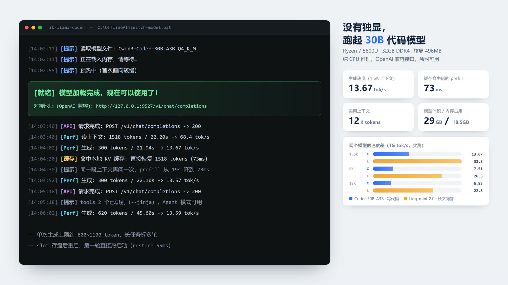

<div align="center">



# 没有独显的笔记本，跑起 30B 代码模型

一台 Ryzen 7 5800U / 32GB 核显本上的纯 CPU 本地大模型工作台

<sub>OpenAI 兼容接口 · 断网可用 · 零 API 费用 · 代码不出本机</sub>


</div>

> **一句话**：不是「云端 API 的穷人替代品」，而是**一台断网也能用的 30B 代码助手**，跑在一台三年前的无独显轻薄本上。

---

## 先看数字

| 指标 | 实测值 | 说明 |
|---|---|---|
| 生成速度 | **13.67 tok/s** | 30B MoE（激活 3B），1.5K 上下文，纯 CPU |
| 二次提问 prefill | **19s → 73ms** | prompt 缓存命中，省掉 99.6% 的重复计算 |
| 实用上下文 | **12K token** | 再往上（15K）会触发内存页回收，速度直接崩 |
| 模型落盘 / 内存占用 | **29GB / 18.5GB** | 32GB 内存可跑，但得关浏览器 |
| 每月 API 费用 | **¥0** | 除了电费 |
| 代码质量（6 题 pass@1） | **5/6** | Qwen3-Coder-30B，和云端小模型打平 |

<!-- 说明：速度取 3 轮均值，热衰减 ±10%，对比看相对值。 -->

---

## 为什么值得折腾这一套

**1. 代码不出本机。** 公司代码、没发布的稿子、带客户信息的日志——这些本来就不该粘进别人的网页输入框。这套跑在 `127.0.0.1` 上，网线拔了照样用。

**2. 没有显卡，不等于不能跑大模型。** 大多数人卡在一个误解上：以为本地部署 30B 需要 4090。其实 MoE 模型每生成一个 token 只激活一小部分参数——30B 的模型实际只算 3B，这才是它能在 CPU 上跑起来的原因。

**3. 免费的部分比想象中多。** 补全、改 bug、写单元测试、解释一段老代码，这些高频操作现在的云端 API 一次几毛钱，一个月下来就是几百块。本地跑，边际成本是 0。

**4. 一次调好，长期可用。** 所有参数集中在一个 `.env` 里，双击一个 bat 就启动，启动一次模型常驻内存。不折腾的时候，它就是个本地服务。

---

## 它是怎么做到的

三件事，缺一不可。

### 一｜选 MoE，不选 dense

同样的参数规模，dense 模型每生成一个 token 都要把**全部**权重从内存读一遍；MoE 只读被激活的那几个专家。

- `Qwen3-Coder-30B-A3B`：总参数 30B，**每个 token 只激活 3B**
- `Ling-mini-2.0`：总参数 16B，**每个 token 只激活 1.4B**

在 CPU 上，速度瓶颈几乎完全等于内存带宽，所以「激活参数量」直接决定快慢。这是整件事成立的前提。

### 二｜换引擎，换掉一半的等待

用 [ik_llama.cpp](https://github.com/ikawrakow/ik_llama.cpp)（`znver2-avx2` 构建，build 5481），实测对比官方 llama.cpp：

| 指标 | 提升 |
|---|---|
| 冷启动 prefill（PP） | **3.4 倍** |
| 4K 上下文生成（TG） | **2.1 倍** |
| 短上下文生成 | +16% |

官方版已弃用——同一台机器上它慢 2~3 倍，这不是调参能追回来的差距。

### 三｜把缓存用尽

CPU 跑大模型最贵的不是「生成」，是「读上下文」。12K 上下文冷启动要 8.4 分钟，人早就走了。

所以做了两层缓存：

- **prompt 缓存**：同一段上下文第二次提问，prefill 从 19 秒降到 **73 毫秒**
- **KV 缓存槽**（`--slot-save-path`）：4K 上下文存盘 111ms / 205MB，重启后 restore **55ms**——服务重启后第一轮就是热的

> ⚠️ 唯一的硬伤：prompt 缓存按 4096 token 分段复用，13K 上下文每轮仍要重算约 9K。所以 agent 多轮长对话会慢，**这是当前最大的痛点**，靠控制上下文长度缓解。

---

## 实测数据

### 速度矩阵（TG tok/s，三档上下文 × 两个模型）

| 上下文档位 | Coder-30B-A3B | Ling-mini-2.0 | 差距 |
|---|---|---|---|
| short ~1.5K | 13.67 | 29.7 ~ 33.8 | 2.3× |
| mid ~8K | 7.51 | 26.3 ~ 27.0 | 3.5× |
| full ~12K | 6.83 | 22.8 | 3.3× |
| 3K→12K 衰减 | **-50%** | **-32%** | — |
| 内存占用 | 18.5GB | 10.5GB | — |

冷启动 prefill（12K）：Coder **8.4 分钟** → Ling-mini **约 2 分钟**（3.7×）。

### 质量（temp=0，6 题自动判分）

| | Coder-30B-A3B | Ling-mini-2.0 |
|---|---|---|
| 编程正确率 | **5/6** | 2/6 |
| tool-calling 两轮闭环 | PASS | PASS |

Ling-mini 的 4 个 FAIL 很有代表性：`+86` 前缀丢首位、正则方括号转义写成 `$$`、`nonlocal` 作用域错、数组合并只 append 不替换。**结论：Ling-mini 只配纯文本场景，写代码和 Agent 一律用 Coder。**

---

## 先说清楚它做不到什么

诚实比宣传重要。这套方案有三个明确的边界：

| 边界 | 表现 | 能忍吗 |
|---|---|---|
| **首轮 prefill 慢** | 12K 上下文冷启动 2~8 分钟 | 长文场景建议先热一次再用 |
| **单次生成上限** | 约 600~1100 token（`n_predict` 调不上去） | 长代码任务要拆多轮 |
| **不是聊天机器人体验** | 13 tok/s ≈ 比人说话快一点，比云端慢 | 适合「扔个任务等结果」，不适合闲聊 |
| **无视觉 / 无联网** | 纯文本，知识截止取决于模型 | — |
| **不适合并发** | 单实例串行处理 | 个人用够了，别当服务端 |

如果你的需求是「秒回」或「多人同时用」，这套方案不合适——直接用云端 API。

---

## 快速开始

### 0. 硬件门槛

| 项 | 最低 | 本文实测机 |
|---|---|---|
| 内存 | 24GB（跑 16B MoE）/ 32GB（跑 30B MoE） | 32GB DDR4-3200 |
| CPU | 8 核，支持 AVX2 | Ryzen 7 5800U 8C16T |
| 显卡 | **不需要** | Vega 8 核显 496MB（等于没有） |
| 硬盘 | 40GB 空闲 | 512GB NVMe |
| 系统 | Windows 10/11 | Windows 11 |

> 核显 offload **实测排除**：显存比模型小，没有带宽增益，只是多一层拷贝。

### 1. 放代码

```bat
git clone https://github.com/edrin09/offline-ai.git C:\OfflineAI
```

路径可以换，但 `.env` 里的路径要跟着改（一共 6 个键）。

### 2. 装引擎

把 `ik_llama.cpp` 的 Windows x64 预编译包（按你的 CPU 微架构选 `znver2-avx2` / `znver3` / 通用 `avx2`）解压到：

```
C:\OfflineAI\main\ikllama\
```

确认 `main\ikllama\llama-server.exe` 存在即可。编译产物约 147MB。

### 3. 下模型（约 29GB）

| 用途 | 模型 | 去哪下 |
|---|---|---|
| 写代码 / Agent | `Qwen3-Coder-30B-A3B-Instruct-Q4_K_M.gguf` | HuggingFace 搜 `Qwen3-Coder-30B-A3B-Instruct-GGUF` |
| 读长文 / 问答 | `Ling-mini-2.0-Q4_K_M.gguf` | ModelScope：[`inclusionAI/Ling-mini-2.0-GGUF`](https://modelscope.cn/models/inclusionAI/Ling-mini-2.0-GGUF)（国内 9MB/s，稳） |

两个都放到 `C:\OfflineAI\main\models\`，**文件名必须和 `.env` 里的一致**。

> 只跑一个也行：另一个的路径留在 `.env` 里，启动时只体检你按的那个。

### 4. 改 `.env`（通常只需要两行）

```ini
# 你机器上的 Python 解释器绝对路径（用来跑日志美化器）
PYTHON=C:\uv\py3.14.8\Scripts\python.exe

# 如果没装在 C:\OfflineAI，把这 4 个路径改成你的实际位置
SERVER_DIR=C:\OfflineAI\main\ikllama
MODELS_DIR=C:\OfflineAI\main\models
SLOTS_DIR=C:\OfflineAI\main\slots
LOGS_DIR=C:\OfflineAI\logs
```

> ⚠️ `.env` **必须存成 Windows CRLF 换行**。cmd 的 `for /f` 只认 CRLF，存成 LF 会导致整份配置读不进来（`.gitattributes` 已经帮你钉住了）。

### 5. 启动

双击 `switch-model.bat`：

```
============================================
  Model Switcher - ik_llama.cpp  (port 9527)
============================================
  [1] Coder  - Qwen3-Coder-30B-A3B...  (coding / agent / tool-calling)
  [2] Office - Ling-mini-2.0...        (long text / QA)
============================================
Select model [1/2]:
```

按 **1** 或 **2**，等控制台出现绿色横幅：

```
[就绪] 模型加载完成，现在可以使用了!
[就绪] 对接地址 (OpenAI 兼容): http://127.0.0.1:9527/v1/chat/completions
[就绪] 模型状态页(浏览器打开): http://127.0.0.1:9527
```

首次加载要把 17.3GB 权重整个读进内存（NVMe 上是几十秒量级，机械盘会很难受），之后就常驻了，重启一次即可长期用。

---

## 接进你的编辑器

服务是标准 OpenAI 接口，任何支持「自定义 Base URL」的客户端都能接：

```bash
curl http://127.0.0.1:9527/v1/chat/completions \
  -H "Content-Type: application/json" \
  -d '{
    "model": "local",
    "messages": [{"role": "user", "content": "解释一下这段代码在做什么"}],
    "stream": true
  }'
```

客户端里填这三个：

| 填什么 | 值 |
|---|---|
| Base URL / API Base | `http://127.0.0.1:9527/v1` |
| API Key | 随便填（不校验，`sk-no-key` 即可） |
| Model | 随便填（服务端只有当前加载的那一个） |

长期用 OpenCode 对接；任何支持自定义 Base URL 的客户端（Continue、Cline、自己写的 `openai` 脚本）配置方式相同。

**Agent / tool-calling 能用**，因为启动参数里带了 `--jinja`——这个参数**不能省**，缺了带 `tools` 的请求直接返回 500。

---

## 两个模型怎么选

| 你要做什么 | 按哪个 | 为什么 |
|---|---|---|
| 写代码、改代码、补全、Agent、tool-calling | **1 / Coder** | 编程正确率 5/6 vs 2/6，无思考税 |
| 读长文档、问答、总结、改写、翻译 | **2 / Ling-mini** | 快 2.3~3.6 倍，占用内存少 8GB |

**选型只看两件事：任务类型 + 上下文长度。** 任务难度（简单/中等/复杂）对速度没有实质影响（±5% 噪声内）。

- 上下文预计 > 4K 的纯文本任务 → 优先 Ling-mini
- 估 token：办公类 ≈ 字符数 ÷ 1.9，Coder 类 ≈ 字符数 ÷ 4

---

## 调参：只改 `.env`，不改代码

`switch-model.bat` 和 `main/log_filter.py` 读的是同一份 `.env`。改参数只改这一个文件。

| 想改什么 | 改哪个键 |
|---|---|
| 端口 / 监听地址 | `PORT` `HOST` |
| 装到别的盘 | `SERVER_DIR` `MODELS_DIR` `SLOTS_DIR` `LOGS_DIR` |
| 换模型 | `MODEL_CODER` `MODEL_OFFICE`（只写文件名） |
| 上下文 / 线程 / batch / KV 量化 | `CTX_SIZE` `THREADS` `BATCH` `UBATCH` `CACHE_TYPE_K` `CACHE_TYPE_V` |
| 思考税开关 | `REASONING`（默认 `off`） |

配错不会静默失败：启动前会逐个体检 Python、引擎、美化器、所选模型文件，缺哪个直接报 `[error]` 并停住等按键。

**现行最优参数**（实测过 5 组组合，这组最好）：

```
--ctx-size 16384 -ctk q8_0 -ctv q8_0 -cram 2048 --jinja --slot-save-path ...\main\slots
线程数 8（写 12 是负优化，超线程帮不上忙）
```

---

## 九个坑，都踩过

写进文档的都是实测结论，不是猜的。

1. **`--jinja` 不能省** —— 缺了带 `tools` 的请求直接 HTTP 500
2. **上下文守 12K** —— 15K 触发内存页回收，速度从 14 掉到 1~3 tok/s 并卡死
3. **内存总占用 ≤ 26GB** —— 超了会 swap，跑模型前关浏览器
4. **官方 llama.cpp 要换掉** —— 慢 2~3 倍，换引擎是收益最大的一步
5. **核显 offload 没用** —— 显存比模型小，纯属多一层拷贝
6. **`.env` 必须 CRLF** —— cmd 的 `for /f` 只认 CRLF，LF 存进去整份配置失效
7. **线程数写 8，不是 12** —— 物理核数，不是逻辑核数
8. **投机解码默认关** —— 开放任务 -10%，只有改写类 +16%，草稿模型已删
9. **reasoning 模型别设 stop 词** —— stop 会命中思考过程里的代码块，输出全废

---

## 硬件换算：你的机器能跑多快

不用试，可以估。

```
生成速度(tok/s) ≈ 有效内存带宽 ÷ 每 token 需读的权重体积
每 token 体积  ≈ 激活参数量 × 量化字节数（Q4_K_M ≈ 0.55 字节/参数）
```

验证一下：3B 激活 × 0.55 ≈ 1.65GB；本机有效带宽约 27GB/s（DDR4-3200 双通道理论峰值 53%）→ 估算 16.4 tok/s，实测 13.67 tok/s。差值是调度与 KV 开销，公式够用。

内存需求 ≈ 总参数 × 0.55 + KV 缓存(q8) + 1~2GB 开销。30B × 0.55 = 16.5GB + 1.5GB ≈ 18.5GB，与实测一致。

**结论**：CPU 方案已经接近物理极限（带宽利用率 53%）。想要质变，只能上独显或云 GPU——**这不是调参能解决的**。

---

## 目录结构

```
C:\OfflineAI\
├── switch-model.bat        # 唯一入口：选 1 或 2，一键启动
├── .env                    # 所有可调参数（端口/路径/模型/推理参数/日志）
├── README.md               # 你在看的这份
├── docs\
│   ├── benchmarks.md       # 完整实测数据、决策红线、复测方法
│   └── screenshots\
├── main\
│   ├── ikllama\            # 引擎（llama-server.exe 及全部工具，147MB）
│   ├── models\             # GGUF 权重（29GB，不入库）
│   ├── slots\              # KV 缓存槽（重启热启动）
│   └── log_filter.py       # 控制台日志美化器（中文提示 + 按天落盘）
└── logs\                   # llama-YYYY-MM-DD.log，按天滚动，5MB 自动分卷
```

---

## 常见问题

**Q：为什么不直接在网页版用？**
A：能问的问题不一样。带客户信息的日志、没发布的合同、公司内部代码——这些不该上传到别人的服务器。这里的边界是「物理上出不去」。

**Q：13 tok/s 是不是太慢了？**
A：慢，但够用。生成 300 token（约 200 个汉字）要 22 秒左右，读起来反而不觉得卡。真正的时间成本在首轮 prefill（12K 上下文要 2~8 分钟），所以用法是「一次扔个大任务，走开干别的」，不是「一问一答盯着看」。

**Q：为什么不量化到 Q3 换速度？**
A：实测过，质量下降不值那点速度。宁可缩小模型（30B → 16B MoE），也不降低量化精度。

**Q：能跑视觉模型吗？**
A：放弃了。核显显存不够，也没有合适的多模态 GGUF。真需要看图，用云端。

**Q：为什么不打包成 Docker / 跨平台？**
A：这套方案的性能全部来自「贴着这台机器调」——`znver2-avx2` 构建、线程绑物理核、KV 量化组合。抽象一层就丢掉 20~30%。要的是能用的极致，不是能移植的通用。

---

## 更多

- **完整实测数据、决策红线、换模型复测方法（3×3 方法 + 脚本）** → [`docs/benchmarks.md`](docs/benchmarks.md)
- **仓库维护约定** → [`AGENTS.md`](AGENTS.md)

## 许可

代码 MIT。两个模型各有自己的许可：Qwen3-Coder 为 Apache-2.0，Ling-mini-2.0 为 MIT。

<div align="center">
<sub>如果你也在没有显卡的机器上折腾本地模型，欢迎开 issue 报一下你的实测数字。</sub>
</div>
